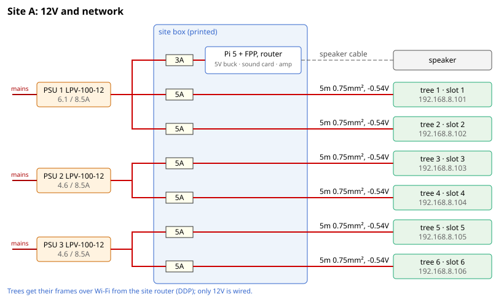
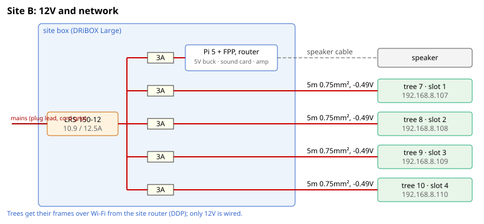
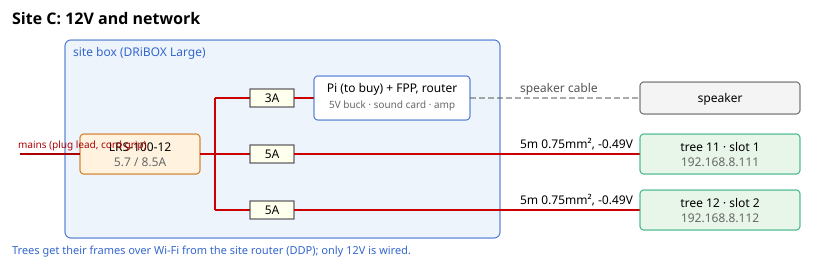

# Site wiring

Generated by tools/gen_site_wiring.py from data/sites.json; don't edit.

**Defaults, not yet confirmed by Rob:** tree counts per site and every run length. Edit data/sites.json and run `make all`.

Each site: one enclosed Mean Well LRS PSU inside the site box (a DRiBOX Large), sized to the site; each tree on its own run from the site box, fused 3A in a blade fuse box with a negative bus. The show player (Pi, sound card, PAM8610) has its own 3A fuse and the router its own 2A. Loads: 2.1A per tree (WLED's brightness limiter holds the pixels to 2A; full white unlimited would be 2.3A), 1.5A for the player, 1.0A for the router. The PSU is the smallest that carries the site at no more than 90%.

The PSU's mains terminals sit under a printed cover; its mains lead comes in through a cord grip and plugs into an RCD-protected outdoor socket (or a weatherproof socket box on one).

## Site A (6 trees, player Pi 3)

PSU: Mean Well LRS-200-12, 14.1A of 17A (83%). The router is indoors on its own adapter, cabled to the Pi by Ethernet.

| Slot | Tree | IP | Fuse | Run | Flex | Drop | At the tree |
|---|---|---|---|---|---|---|---|
| 1 | 1 (stairtree-01) | 192.168.8.101 | 3A | 5m | 0.75mm² | 0.49V | 11.5V |
| 2 | 2 (stairtree-02) | 192.168.8.102 | 3A | 5m | 0.75mm² | 0.49V | 11.5V |
| 3 | 3 (stairtree-03) | 192.168.8.103 | 3A | 5m | 0.75mm² | 0.49V | 11.5V |
| 4 | 4 (stairtree-04) | 192.168.8.104 | 3A | 5m | 0.75mm² | 0.49V | 11.5V |
| 5 | 5 (stairtree-05) | 192.168.8.105 | 3A | 5m | 0.75mm² | 0.49V | 11.5V |
| 6 | 6 (stairtree-06) | 192.168.8.106 | 3A | 5m | 0.75mm² | 0.49V | 11.5V |

## Site B (4 trees, player Pi 5)

PSU: Mean Well LRS-150-12, 10.9A of 12.5A (87%). The router is on the PSU (2A fuse).

| Slot | Tree | IP | Fuse | Run | Flex | Drop | At the tree |
|---|---|---|---|---|---|---|---|
| 1 | 7 (stairtree-07) | 192.168.8.107 | 3A | 5m | 0.75mm² | 0.49V | 11.5V |
| 2 | 8 (stairtree-08) | 192.168.8.108 | 3A | 5m | 0.75mm² | 0.49V | 11.5V |
| 3 | 9 (stairtree-09) | 192.168.8.109 | 3A | 5m | 0.75mm² | 0.49V | 11.5V |
| 4 | 10 (stairtree-10) | 192.168.8.110 | 3A | 5m | 0.75mm² | 0.49V | 11.5V |

## Site C (2 trees, player Pi (to buy))

PSU: Mean Well LRS-100-12, 6.7A of 8.5A (79%). The router is on the PSU (2A fuse).

| Slot | Tree | IP | Fuse | Run | Flex | Drop | At the tree |
|---|---|---|---|---|---|---|---|
| 1 | 11 (stairtree-11) | 192.168.8.111 | 3A | 5m | 0.75mm² | 0.49V | 11.5V |
| 2 | 12 (stairtree-12) | 192.168.8.112 | 3A | 5m | 0.75mm² | 0.49V | 11.5V |

## Site D (2 trees, player Pi (to buy))

PSU: Mean Well LRS-100-12, 6.7A of 8.5A (79%). The router is on the PSU (2A fuse).

| Slot | Tree | IP | Fuse | Run | Flex | Drop | At the tree |
|---|---|---|---|---|---|---|---|
| 1 | 13 (stairtree-13) | 192.168.8.113 | 3A | 5m | 0.75mm² | 0.49V | 11.5V |
| 2 | 14 (stairtree-14) | 192.168.8.114 | 3A | 5m | 0.75mm² | 0.49V | 11.5V |

## Shopping totals

- 2 × Mean Well LRS-100-12
- 1 × Mean Well LRS-150-12
- 1 × Mean Well LRS-200-12
- 1 spare Mean Well LRS-200-12 later: it covers any site
- 4 × blade fuse boxes with a negative bus (10-way); 18 × 3A and 3 × 2A blade fuses (plus spares)
- 77m of 2-core 0.75mm² outdoor flex (runs + 10%)
- 14 × PY07 Z108 2-pin bayonet connector sets, one per run (plus spares): socket on the run, pins on the tree's pigtail, red to +
