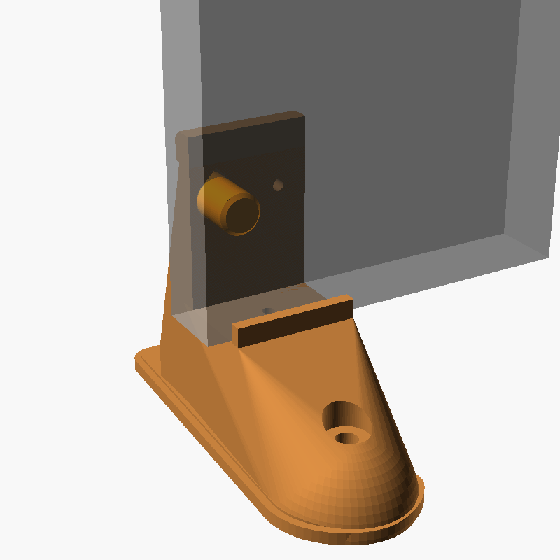
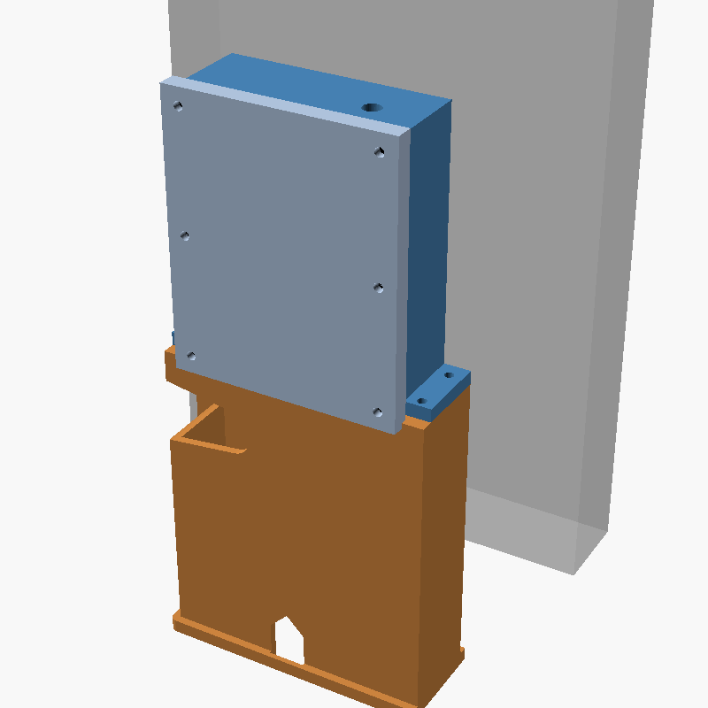

# Tree boots

 

`stair-tree-foot.scad` is parametric (every dimension at the top). The STLs are exported from it:

```
openscad -o stair-tree-foot-right.stl -D 'hand="right"' stair-tree-foot.scad   # plain boot
openscad -o stair-tree-foot-left.stl  -D 'hand="left"'  stair-tree-foot.scad   # control boot
openscad -o stair-tree-peg.stl        -D 'part="peg"'   stair-tree-foot.scad   # 2 per tree
```

`-D 'part="preview"'` shows a boot with its peg, the controller box and a ghost of the tread (for looking at, not printing).

Two boots per tree, one at each old 17mm fixing hole in the wide end; 28 in all, plus 28 pegs. Each boot:
- carries the tree's bottom edge on a shelf 50mm above the ground, in a slot between a low front lip (8mm, below the bottom pixel row) and the shaft wall
- is located by a separate **peg** through the shaft wall into the old fixing hole; the wood screw for the old pilot hole goes through the peg's tab, so one screw holds the boot and the peg
- is pegged down with two 8mm × 200mm nails, one through the toe cap and one through the heel

**Why the peg is separate:** the first version had the spigot moulded on, sticking into the slot. The tree has to drop into the slot from above (the lip is in front of it, the shaft behind), so a fixed spigot made it impossible to assemble.

## Plain boot (right) and control boot (left)

Node 1, where the pixel data goes in, is at the base-left of the tree, right behind the left boot. So the left boot is the **control boot**: behind the shaft it has a hollow tower, and the tree controller box (`enclosure/tree-box.scad`) sits on top of it, behind the tree and inside its outline, so you can't see it from the front.

- **Pixel lead**: out of the tree through the exit slot in its bottom edge (`BACK_POCKET` layer of the CNC file), down through the 16mm hole in the shelf into the toe hollow, back through the arch in the shaft into the tower, where it plugs into the box's PG7 tail.
- **12V flex**: in through the arch at the bottom of the tower's back wall, up to the box's PG9 gland.
- Both glands point down into the tower, so no entry on the box faces the rain. The tower is open underneath, so it drains and airs.
- The box sits on four corner posts and is held by four M3 screws through its ears into heat-set inserts.

## Assembly

1. Push the M3 heat-set inserts into the tops of the control boot's four tower posts.
2. Stand both boots on blocks (the pixel lead needs to hang down through the control boot) and lower the tree into them from above. Feed the pixel lead and its xConnect plug down through the shelf hole as the tree goes in.
3. From behind, push a peg through each boot's shaft into the old fixing hole. Drive a 4mm wood screw through the peg's tab into the old pilot hole.
4. Stand the tree up where it lives. Nail the toes and heels. In the control boot, the heel nail is inside the tower: hammer it before fitting the box.
5. Thread the pixel lead through the arch into the tower and plug it into the box's tail. Bring the 12V flex in through the back arch.
6. Fit the box on the tower (four M3 screws), screw the antenna on.

## Printing (Bambu P1S)

Boots upright on the sole, no supports, PETG, 3 walls, 15% infill. Horizontal holes are teardrops and cavity roofs are sloped. Pegs: head down, no supports.

| Part | Size (mm) | Solid volume | Each tree |
|---|---|---|---|
| Plain boot | 59 × 164 × 120 | 153 cm³ | 1 |
| Control boot | 121 × 149 × 120 | 198 cm³ | 1 |
| Peg | 43 × 19 × 33 | 9 cm³ | 2 |

The real mass is lower than the solid volume (15% infill); Bambu Studio gives the exact figure.

Print one pair and two pegs, and test-fit them before printing 28. Check on a real tread:
- tread thickness (slot is 30 + 1.5mm)
- the old hole's diameter and depth (peg 16.6mm, 20mm deep)
- hole height above the bottom edge (44mm from the photo) and pilot offset (26.5mm)
- the pilot hole's diameter, which decides the screw: the design assumes a 4mm screw (4 × 40)
- that the xConnect plug passes the 16mm shelf hole
